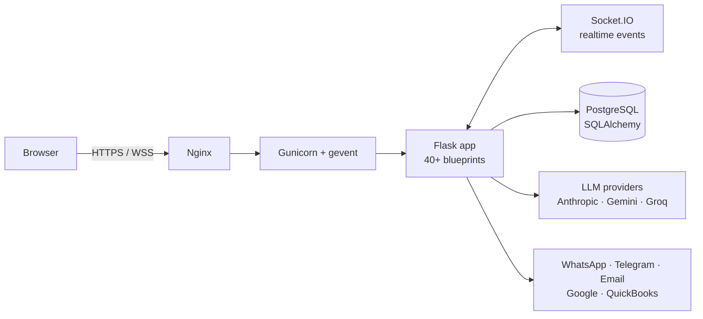

  

  
   
  14-second product tour · <a href="assets/demo.mp4">full-quality MP4 (1080p)</a>

---

**Portfiva** is a CRM I designed and built from scratch for real estate agents, whose clients mostly reach them on WhatsApp.
It brings every conversation into one inbox, uses LLMs to draft replies and score leads, and keeps the whole team's
sales pipeline in sync in real time.

> The source code is private (commercial project). This repository is the public showcase: product overview,
> architecture and demo. I'm happy to walk through the code in an interview — reach me on
> [LinkedIn](https://www.linkedin.com/in/yigitguldal).

## What it does

| | |
|---|---|
| **Unified inbox** | WhatsApp, Telegram and email in one place, with SLA tracking, tags and assignment. |
| **AI assistant** | Drafts replies, summarizes threads and runs sentiment analysis. Provider-agnostic: Anthropic, Google Gemini and Groq. |
| **Live pipeline** | Kanban deals, lead scoring and team updates pushed over WebSockets — no page reloads. |
| **Automation** | Workflow builder for triggers and actions (e.g. move a deal when a viewing is booked), scheduled and bulk messages. |
| **Integrations** | Google Workspace (Calendar & Contacts via OAuth), QuickBooks, Telegram bot, webhooks and a documented public REST API with JWT auth. |
| **Multi-tenant SaaS** | Team roles and permissions, onboarding flow, super-admin panel, English and Turkish UI. |

## Architecture

- **Modular monolith:** 40+ Flask blueprints (inbox, pipeline, automation, integrations, public API…) sharing one domain model.
- **Realtime by default:** Flask-SocketIO on gevent workers broadcasts deal, message and notification events to each team room.
- **Security:** Flask-Login sessions, JWT for the public API, rate limiting (Flask-Limiter) and Origin/Referer CSRF enforcement with SameSite cookies.
- **i18n:** Flask-Babel with full English and Turkish catalogs.
- **Tested:** pytest suite (26 modules) covering permissions, public API security, workflow reliability, pipeline and integrations.

## Tech stack

`Python` `Flask` `SQLAlchemy` `PostgreSQL` `Flask-SocketIO` `gevent` `Jinja2` `JavaScript` `JWT`
`Anthropic API` `Google Gemini` `Groq` `Google OAuth` `QuickBooks API` `Telegram Bot API`

## About this repo

| Path | What it is |
|---|---|
| `assets/banner.svg` | Animated header (respects `prefers-reduced-motion`). |
| `assets/demo.mp4`, `assets/demo.gif` | Product tour. |
| `assets/cover.png` | 1200×627 social / LinkedIn cover. |
| `motion/` | The demo's source: an HTML scene with a deterministic `render(t)` timeline, rendered frame-by-frame with headless Chrome and encoded with ffmpeg (`node render.mjs frames`). |

The demo uses a stylized re-creation of the UI with fictional data — no real customer information.

---

Designed & built by **Yiğit Güldal** · Economics @ Anadolu University
